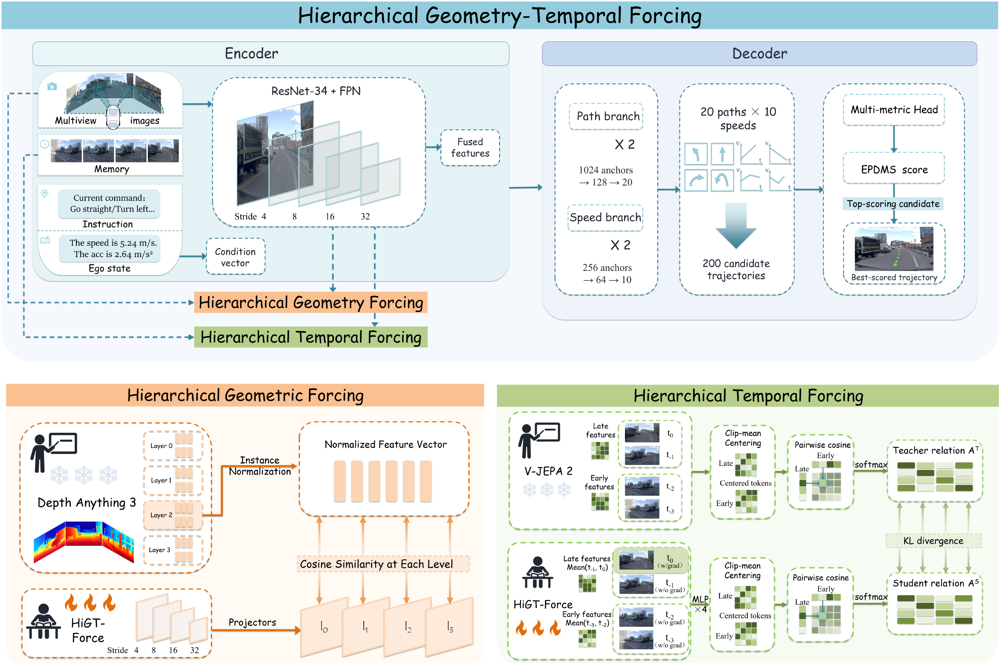
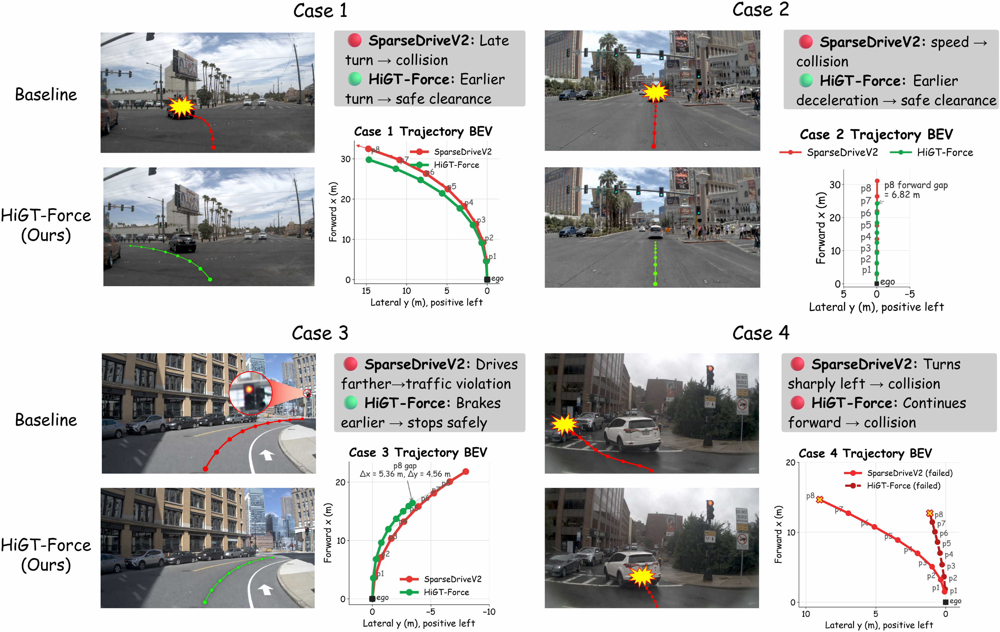

# HiGT-Force

**Empowering End-to-End Driving with Hierarchical Geometry-Temporal Forcing**

HiGT-Force introduces complementary geometric and temporal supervision at multiple levels of a driving planner’s visual feature pyramid. Frozen geometry and video teachers guide representation learning during training. At inference, both teachers and the projection heads are removed, preserving the baseline planning pipeline.

## Overview

- **Geometric forcing:** Aligns student features with spatially corresponding representations from a frozen DA3 teacher.
- **Temporal forcing:** Matches cross-frame association distributions derived from a frozen V-JEPA 2 teacher.
- **Hierarchical supervision:** Applies both objectives at four feature-pyramid levels alongside the planning loss.

## Results

| Benchmark | Metric | Baseline | HiGT-Force |
| --- | --- | ---: | ---: |
| NAVSIM v2 | Mean EPDMS ↑ | 90.10 | **92.33** |
| NAVSIM v1 | PDMS ↑ | 92.0 | **93.8** |
| Bench2Drive | Driving Score ↑ | 87.45 | **89.50** |
| Bench2Drive | Success Rate (%) ↑ | 67.27 | **70.91** |

Under a shared candidate pool, HiGT-Force reduces the gap between the pool-oracle EPDMS and the selected trajectory’s EPDMS by **21.3%** relative to Baseline.

## Qualitative Results

## Resources

This repository contains the HiGT-Force project website.

- Paper: Coming soon
- Supplementary material: Coming soon
- Training and evaluation code: Coming soon
